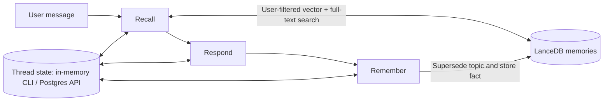

# LangGraph + LanceDB long-term memory

## Headline result

On all **500 LongMemEval-S cleaned questions**, retrieved session memory raised
answer accuracy from **31/500 (6.2%)** without memory to **351/500 (70.2%)**
with memory, using the benchmark's published `gpt-4o-2024-08-06` evaluator.
Claude Haiku 4.5 generated both sets of answers. The separate Claude Sonnet
4.6 grading run scored the same answers at 26/500 (5.2%) and 333/500 (66.6%).
The [evaluation report](evals/quality_and_scale.md) includes the protocol,
per-question labels, and reproducibility checks.

| Question type | Questions | Without memory | With memory |
| --- | ---: | ---: | ---: |
| Knowledge update | 78 | 6 (7.7%) | 61 (78.2%) |
| Multi-session | 133 | 12 (9.0%) | 82 (61.7%) |
| Single-session assistant | 56 | 0 (0%) | 56 (100%) |
| Single-session preference | 30 | 0 (0%) | 13 (43.3%) |
| Single-session user | 70 | 7 (10.0%) | 63 (90.0%) |
| Temporal reasoning | 133 | 6 (4.5%) | 76 (57.1%) |

**Caveat:** This uses the official evaluator, but is not a leaderboard
submission. The run stored whole sessions and did not test the fact extractor.

Agents need durable facts across conversations, and a chat thread alone cannot
provide them. This example stores user-scoped memories in embedded LanceDB,
which provides local vector search, full-text search, and filters in one table
without a database server. A LangGraph agent recalls relevant memories,
answers, and saves newly stated facts. Synthetic and public-dataset
evaluations measure retrieval and answer quality, stale results, and
cross-user leakage.

## Architecture



`InMemorySaver` keeps a thread's message history only while the process runs. LanceDB persists memories across threads and process restarts. The CLI starts a new thread on each launch, so a later launch demonstrates cross-thread recall.

## Authenticated API (code only)

The optional HTTP service adds OIDC bearer-token verification, conversation ownership,
PostgreSQL checkpoints, per-user memory listing, and account-data deletion. It requires
a real OpenAI or Anthropic model; the deterministic demo is available only in the CLI
and tests. The API derives its user ID from a validated token's issuer and subject;
clients cannot submit an arbitrary user ID. The model receives prior messages in the
conversation, as well as retrieved long-term memories.

**Users do not need a model, provider account, or provider API key.** The service
operator configures one model provider on the server. Its key belongs only in the
server process or secret manager; it is never sent to clients or included in an API
response. Users authenticate to this API with their own OIDC access tokens. The
operator pays for model calls, so add quotas and abuse controls before public access.
If no operator-controlled model access is available, the live API cannot answer
questions; the CLI's explicit demo is only for offline development.

Install `uv sync --locked --extra server --extra openai` (or `--extra anthropic`).
Configure `DATABASE_URL`, `MEMORY_DB_PATH`, `OIDC_ISSUER`, `OIDC_AUDIENCE`,
`OIDC_JWKS_URL`, your provider model name, and its API key in the process environment.
See [.env.example](.env.example) for names. Do not commit a populated `.env` file.
The OIDC provider must issue RS256 **access tokens** with `iss`, `aud`, `sub`, `iat`,
and `exp` claims. Point `OIDC_AUDIENCE` at the API audience, not a web client ID.
Run `uv run --extra server --extra openai agent-memory-api` (or Anthropic).
The entry point binds to `127.0.0.1:8000`; place it behind an HTTPS reverse proxy
when serving remote users.

```sh
curl -X POST http://127.0.0.1:8000/v1/conversations \
  -H "Authorization: Bearer $ACCESS_TOKEN"
curl -X POST http://127.0.0.1:8000/v1/conversations/$CONVERSATION_ID/messages \
  -H "Authorization: Bearer $ACCESS_TOKEN" \
  -H "Content-Type: application/json" \
  -d '{"request_id":"YOUR_NEW_UUID","text":"I live in Denver."}'
```

`GET /v1/conversations`, `GET /v1/conversations/{id}/messages`, and
`GET /v1/memories?limit=20` read only the caller's data. `DELETE /v1/me` removes
their conversation metadata, checkpoints, and LanceDB rows. The operation can be
retried if a storage error interrupts it. Existing LanceDB data-file versions and
backups may retain deleted bytes until retention and compaction policies run; do not
promise physical erasure from this endpoint alone.

Each message requires a new UUID `request_id`. Reusing the same ID and text returns
the saved answer without calling the model again, including after a process restart.
Reusing an ID with different text returns 409. If the process crashes after the graph
checkpoint but before saving the answer, the retry recovers the completed turn.
`MAX_CONVERSATION_MESSAGES` (default 40) bounds model context growth; when reached,
start a new conversation. Long-term memories remain available across conversations.

This service intentionally permits **one writer instance** for its local LanceDB
directory. A PostgreSQL advisory lock makes a second instance fail startup; a
process lock serializes local memory operations. Use a dedicated `MEMORY_DB_PATH`
that the CLI and other processes do not write. This is a reviewable pilot, not a
multi-replica deployment. Before serving real users, configure TLS, backups and
retention, provider quotas, request limits, operational monitoring, and an identity
provider; validate the memory extractor and deletion policy on consented data.

## Quickstart

Install [uv](https://docs.astral.sh/uv/getting-started/installation/) and Python 3.11 or 3.12. From the repository root:

```sh
uv sync --locked
uv run python evals/run_eval.py
uv run python -m agent_memory.cli chat --user alice --demo
```

The first evaluation or chat launch downloads the public `BAAI/bge-small-en-v1.5` ONNX model into `data/models/`. No API key is needed for retrieval or the explicit `--demo` chat mode. The evaluation prints its table and writes `evals/results.md`. In chat, try `I live in Denver.`, then `Where do I live?`; enter `/quit` to exit. Reopen chat with the same user to see long-term recall in a new thread.

After dependencies and the model are cached, the full evaluation runs without network access:

```sh
uv run --offline python evals/run_eval.py --offline
```

The CLI tests need no model download: `uv run --offline pytest -q tests/test_graph.py tests/test_store.py tests/test_llm.py` works after `uv sync --locked`. For the full suite, install `--extra server`; the PostgreSQL API integration test runs when `TEST_DATABASE_URL` is set and is otherwise skipped. For a network-free runtime demo without BGE, add `--embedder hash` to the evaluation or chat command. Hash vectors are deterministic token features, not a semantic substitute for BGE. A literal clean clone with no package or model cache needs a one-time download; the repository does not vendor either.

For live chat, run `uv sync --locked --extra openai` or `uv sync --locked --extra anthropic`. Set exactly one provider key (`OPENAI_API_KEY` or `ANTHROPIC_API_KEY`) and its model name (`OPENAI_MODEL` or `ANTHROPIC_MODEL`), then run chat without `--demo`. Without a provider key, normal chat fails clearly instead of silently using a fake model. The explicit demo echoes recalled memories and extracts a few fixed patterns; it is not a general answer model.

## Measured retrieval

The hand-written synthetic dataset has 54 memories for three users across four sessions each and 45 labeled questions. These results were measured locally on Windows with FastEmbed BGE. Recall@k counts a question when a gold memory appears in the first k results; MRR uses its first rank. Stale rate applies only to updated questions and counts a superseded memory ranked above the current answer in the top five. Leak rate counts any result from another user. Median latency includes local embedding and search and will vary by machine. The full question-type table is in [evals/results.md](evals/results.md).

The weighted-fusion sweep and a full 470-question LongMemEval-S cleaned evidence-retrieval run are documented in [evals/weighted_results.md](evals/weighted_results.md). Equal-weight hybrid led the public-data run, so the default remains 0.5. These are retrieval results, not answer-accuracy scores.

The [memory quality and scale report](evals/quality_and_scale.md) also covers
explicit temporal fact comparison and 100,000-row exact-versus-indexed search
tests on **local Windows and AWS**. The full-probe index matched exact top-10
neighbors in both runs but was faster only on the local host.

| Mode | N | Recall@1 | Recall@3 | Recall@5 | MRR | Stale rate | Leak rate | Median ms |
| --- | ---: | ---: | ---: | ---: | ---: | ---: | ---: | ---: |
| recency | 45 | 6.7% | 20.0% | 33.3% | 0.152 | 0.0% | 0.0% | 12.7 |
| vector | 45 | 97.8% | 100.0% | 100.0% | 0.989 | 0.0% | 0.0% | 23.0 |
| hybrid | 45 | 77.8% | 88.9% | 97.8% | 0.839 | 0.0% | 0.0% | 29.4 |
| hybrid+history | 45 | 68.9% | 84.4% | 91.1% | 0.773 | 55.6% | 0.0% | 27.9 |

Vector search performed best overall on this small dataset. RRF hybrid ranked exact-word questions first more often (100% versus vector's 93.3% Recall@1), but its full-text leg hurt paraphrase retrieval (33.3% versus 100% Recall@1). Excluding superseded memories cut the updated-question stale rate from 55.6% to 0% in this run. No mode returned another user's memory in these 45 questions; that measured result is not a security proof.

## Design

- Every search applies a typed `user_id` expression before ranking. Delete and supersession mutations also use typed expressions, so a quoted user ID is treated as data.
- A new memory on a user's topic marks the older one superseded rather than deleting it. LanceDB merge-insert commits the old-row update and new row in one transaction, so a failed write does not remove the active fact. Normal retrieval excludes history; `include_superseded=True` exists for audit and the stale-result comparison. An older backfilled timestamp stays historical.
- Repeated identical active facts return the same memory ID. Explicit `get_topic_at` and `compare_topic` lookups answer before/after queries from timezone-aware timestamps; the CLI exposes the comparison with `agent-memory compare`.
- Hybrid search combines vector and full-text candidates with reciprocal rank fusion (RRF). IDs break ranking ties so retrieval scores are reproducible; latency remains machine-dependent. No vector ANN index is created for this small dataset.
- Evaluation uses isolated temporary LanceDB storage and stable seeded IDs. It never reads or changes the chat database at `data/memory.lance`.

## Limits and next steps

The CLI remains a local single-process example. The authenticated API uses durable PostgreSQL checkpoints and a single-writer lock for local LanceDB; it has not been validated with real consented users or at multi-replica scale. The offline extractor recognizes only a few explicit English phrases; the optional structured LLM extractor still needs validation on real consented data. Useful next steps are tested memory decay or summarization and a remote multi-writer memory store. The synthetic labels and local scale timing do not establish production accuracy or latency.

The LongMemEval answer run indexed complete conversations as memory rows. A
separate benchmark should measure the agent's fact extraction and update path
before claiming end-to-end memory quality.

## Development

```sh
uv sync --locked --extra server
uv run --offline --extra server pytest -q
uv run --offline ruff check .
uv run --offline ruff format --check .
```

GitHub Actions runs these checks on Python 3.11 and 3.12. [MIT license](LICENSE).
